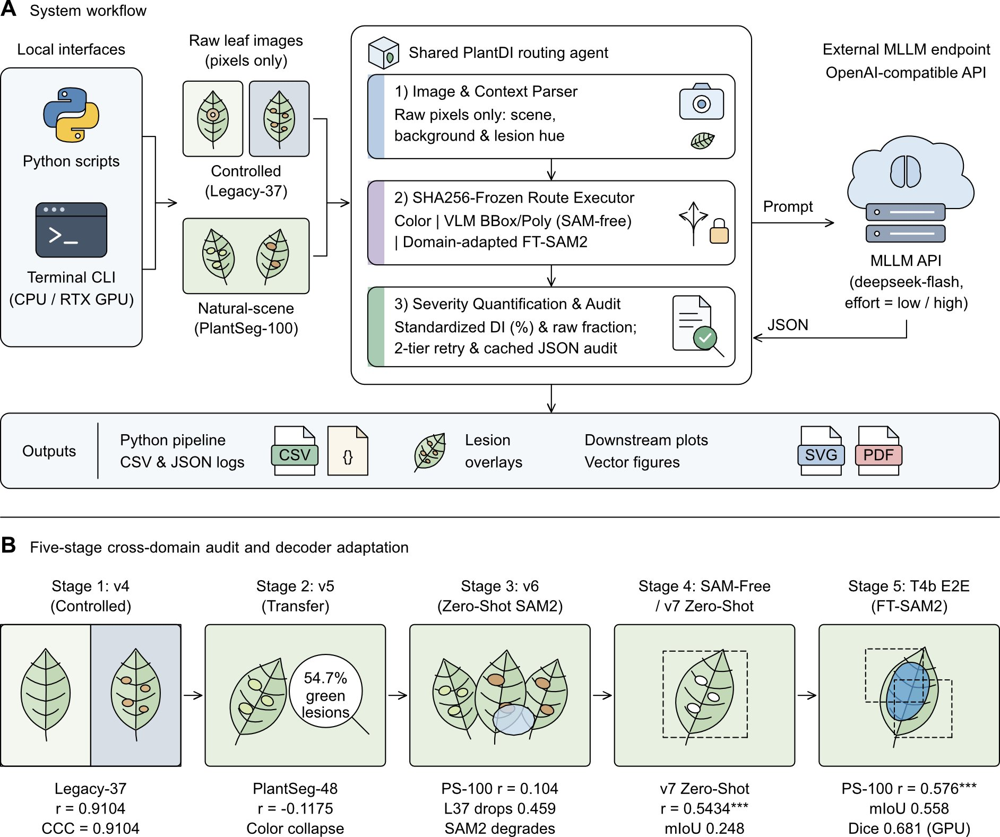

# PlantDI

**Target manuscript (descriptive working title):** *PlantDI: Quantitative Disease Index Estimation in Plant Leaves with Vision-Language Localization and SAM 2 Refinement*. Target journal: *Plant Methods*.

PlantDI is a modular plant-disease phenotyping pipeline that estimates a disease index (DI) from leaf images. It combines:

1. an image-only routing controller that separates strictly controlled panels from natural-scene images,
2. a vision-language model (VLM) that emits lesion polygons or points without any filename, label or ground-truth input,
3. a SAM 2 decoder arm, optionally fine-tuned on the official training split, for pixel-level lesion segmentation, and
4. frozen, train-only calibration and a fixed metric suite (Pearson r, Spearman rho, Lin's CCC, MAE, mIoU, Dice).

All policy, prompts and source hashes are frozen in `v7_expert_alignment/policy_manifest_v7.json`. Evaluation was performed only after freezing, and the frozen per-sample CSV files are the authoritative results.

---

## Overview



**Figure 1. PlantDI system workflow and five-stage cross-domain audit.** **(A) System workflow.**
Python scripts or a terminal CLI (CPU / RTX GPU) send raw leaf pixels only — either controlled
panels (Legacy-37) or natural-scene images (PlantSeg-100) — to a shared routing agent with
three stages: (1) an image and context parser that reads only raw pixels for scene, background
and lesion hue; (2) a SHA256-frozen route executor selecting colour thresholding, VLM bounding
boxes/polygons (SAM-free), or the domain-adapted fine-tuned SAM 2 decoder; and (3) severity
quantification and audit producing a standardised disease index (%) plus raw fractions, with
two-tier retry and a cached JSON audit. The external MLLM endpoint is OpenAI-compatible
(`deepseek-flash`, effort low/high). Outputs are Python CSV/JSON logs, lesion overlays and
downstream vector figures (SVG/PDF). **(B) Five-stage cross-domain audit and decoder adaptation.**
Stage 1, v4 controlled (Legacy-37, r = 0.9104, CCC = 0.9104); Stage 2, v5 transfer
(PlantSeg-48, r = -0.1175, 54.7% green lesions — colour collapse); Stage 3, v6 zero-shot
SAM 2 (PlantSeg-100 r = 0.104, Legacy-37 drops 0.459 — SAM 2 degrades); Stage 4, SAM-free /
v7 zero-shot (r = 0.5434, mIoU = 0.248); Stage 5, T4b end-to-end with the fine-tuned SAM 2
decoder on a local RTX 3060 GPU (r = 0.576, mIoU = 0.558, Dice = 0.681).

---

## Repository layout

```text
.
├── README.md
├── LICENSE
├── requirements.txt
├── .gitignore
├── figures/
│   └── Fig1.jpg                          # overview figure rendered above
├── results/                              # v4 table required by the offline benchmark builder
│   └── predictions_v4_agent.csv
├── v4_controlled/                        # frozen v4 controlled-panel route
│   ├── frozen_policy.py
│   ├── results/
│   │   ├── predictions_v4_agent.csv
│   │   └── trackC_predictions.csv
│   └── scripts/
├── v5_formal/results/stats_summary_v5.csv
├── v6_three_branch/                      # three-branch frozen baseline
│   ├── scripts/
│   ├── results/
│   └── ablation_samfree/
└── v7_expert_alignment/                  # v7 + T4 + T4b
    ├── policy_manifest_v7.json
    ├── RESULTS_v7_FINAL.md
    ├── RESULTS_T4_FINAL.md
    ├── RESULTS_T4b_E2E_FINAL.md
    ├── data/
    │   ├── split_audit.json
    │   ├── plantseg100/                  # metadata and rebuild provenance only
    │   └── plantseg_train/t4_data_audit.json
    ├── weights/sam2_tiny_decoder_ft_audit.json
    ├── results/                          # frozen CSV/JSON results and VLM prompt cache
    ├── scripts/
    ├── src/
    └── tests/offline_selftest.py
```

Raw images, raw labels, parquet shards, wheels and the SAM 2 source tree are intentionally excluded. The fine-tuned decoder weights and the 100 per-image prediction files are distributed as GitHub Release assets.

---

## Data and weights

### PlantSeg-100 and the official splits

- Dataset: PlantSeg, Zenodo DOI **10.5281/zenodo.17719108**.
- `PlantSeg-100` is the 100-image frozen evaluation subset reconstructed from the official parquet files. Its per-image metadata and rebuild provenance are included in `v7_expert_alignment/data/plantseg100/`.
- The official training split contains 7,916 images. `v7_expert_alignment/data/plantseg_train/t4_data_audit.json` records zero overlap with both the official Test split (2,295 images) and PlantSeg-100.
- Images and masks are **not** redistributed in this repository. Download them from the Zenodo record and place them locally as `data/plantseg100/imgs/` and `data/plantseg100/masks/` when a live run is required.

### SAM 2 weights

| Artifact | Where to obtain it | SHA256 |
|---|---|---|
| `sam2_hiera_tiny.pt` (official base weights) | facebookresearch/sam2 release, or the mirror used in the study | `65b50056e05bcb13694174f51bb6da89c894b57b75ccdf0ba6352c597c5d1125` |
| `sam2_tiny_decoder_ft.pt` (fine-tuned decoder) | GitHub Release of this repository | `7a7879fa4ffd235a63c550201d9ce539b20bdba4df01bbd6b26a91c8c5aaa370` |
| `t4b_masks_plantseg100.zip` | GitHub Release of this repository | `997136763bc4d9841a6e86b4d3a826eb7e336a286325df6eb27464a5da26e24b` |

The SAM 2 source is not vendored here. Install facebookresearch/sam2 v1.0 separately and use config `configs/sam2/sam2_hiera_t.yaml` with the tiny checkpoint.

### Frozen hashes

| Frozen object | SHA256 |
|---|---|
| v4 routing policy (`a103bd62...`) | `a103bd6208334ba0c6b8bd8f25916fdaaa028c8e8e0a44f057712cb76b4fa4df` |
| v6 routing policy (`be104b44...`) | `be104b440f7151eeba4e6fa8034967d80492760a521fa9bd58526cdf810a084b` |
| v7 route in `policy_manifest_v7.json` | `9958e71dcdef4137e19c2d634672cb2fdf1657db322d288c3448fa00946a2da4` |
| T4b frozen VLM prompt cache | `782fcc602677bacca9aa24530c57af3906baddbba831ad5c51091a09778c39c2` |

---

## Results at a glance

All metrics are computed on PlantSeg-100 (n=100, original scale). Oracle rows are not deployable.

| Method | Paradigm | r | mIoU | Notes |
|---|---|---:|---:|---|
| Pure VLM | Zero-shot baseline | 0.3316 | 0.2576 | frozen v6 baseline |
| v7 Zero-Shot | Zero-shot, T1-T3 | 0.5434 | 0.2475 | VLM polygons + leaf clipping, no SAM 2 |
| T4 FT-SAM2 | Supervised upper bound | 0.5445 | 0.4963 | oracle GT box; optimistic, not deployable |
| T4b FT-SAM2 | **Deployable, non-oracle** | **0.5756** | **0.5579** | cached VLM prompts + fine-tuned decoder |
| T4b FT-SAM2 + leaf clipping | Deployable, non-oracle | 0.5291 | 0.4288 | nearly unbiased area, lower overlap |

See `v7_expert_alignment/RESULTS_v7_FINAL.md`, `RESULTS_T4_FINAL.md` and `RESULTS_T4b_E2E_FINAL.md` for full metric tables, error attribution and limitations.

---

## Offline verification and metric recomputation

No network access, API key or image data is needed for the first two checks.

```bash
# 1. Verify the frozen v7 manifest (policy, prompts, sources, baselines).
python v7_expert_alignment/scripts/verify_manifest.py

# 2. Network-free, data-free self-test of metrics, client logic and clipping logic.
python v7_expert_alignment/tests/offline_selftest.py

# 3. Recompute the frozen summary from the authoritative per-sample CSV files.
python v7_expert_alignment/src/run_v7_eval.py \
  --plantseg-v7-csv v7_expert_alignment/results/v7_preds_plantseg100.csv \
  --out /tmp/recomputed_benchmark.csv
```

Step 3 rebuilds the baseline rows from `results/predictions_v4_agent.csv` and the frozen v6/SAM-free tables, then recomputes the v7 PlantSeg-100 row from the frozen per-sample predictions. It runs the manifest gate first and aborts if any pinned artifact changed.

For a live VLM run, set the `DEEPSEEK_API_KEY` variable in your shell before invoking `src/run_v7_eval.py --live`. No key is stored in this repository; every script reads the standard environment variable.

---

## License

MIT. Copyright (c) 2026 Fei Liang. See `LICENSE`.
